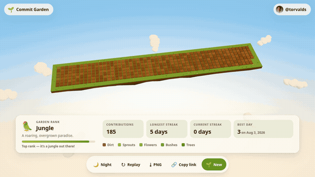

# 🌱 Commit Garden

Turn any GitHub contribution graph into a tiny 3D low-poly garden. Every day of the last year becomes a tile on a floating island, and the busier the day, the bigger the plant that grows on it.

**Live demo: [elfarisssaid19.github.io/commit-garden](https://elfarisssaid19.github.io/commit-garden/)**



## Features

- **Any GitHub user**: type a username (or paste a profile URL) and their last year of contributions grows into a garden.
- **GitHub-style layout**: 53 weeks × 7 weekdays, oldest on the left, Sunday at the back, just like the contribution graph.
- **Grow animation**: plants pop up day by day in chronological order, the whole year in about 4 seconds. Hit **Replay** to watch it again.
- **Procedural low-poly plants**: no external models. Plants get random rotation, scale, offset and color, and each plant type is drawn with `InstancedMesh`.
- **Explore it**: drag to orbit, scroll or pinch to zoom, right-drag or two-finger drag to pan (within limits). The camera slowly auto-rotates when you're idle.
- **Inspect any day**: hover a tile on desktop, or tap it on mobile, to see its date and contribution count.
- **Stats panel**: total contributions, longest streak, current streak, best day, and a fun **garden rank**.
- **Day / night**: the lighting and sky change, and at night fireflies glow around the big trees.
- **Share it**:
  - The URL tracks the garden (`?user=octocat`), so you can link straight to it.
  - **Copy link** copies that URL.
  - **Download PNG** saves a captioned screenshot.
- **Demo garden**: random, offline-friendly data if you just want to look around. Demo links (`?demo=<seed>`) reproduce the same garden.
- **Responsive**: works with mouse, trackpad and touch, from phones to wide screens.
- **Capture mode**: `?user=octocat&capture=1` renders a still, deterministic garden with a caption, made for automated screenshots (see below).

### What grows where

| Contribution level | What grows |
| --- | --- |
| 0 | Bare dirt tile (a few slightly different shades) |
| 1 | Grass sprouts |
| 2 | Flowers in random colors |
| 3 | A bush or a small pine |
| 4 | A big tree with blossoms or fruit (and fireflies at night) |

### Garden ranks

| Contributions in the last year | Rank |
| --- | --- |
| 0 – 99 | 🏜️ Desert |
| 100 – 399 | 🌴 Oasis |
| 400 – 999 | 🌼 Meadow |
| 1,000 – 2,499 | 🌲 Forest |
| 2,500+ | 🦜 Jungle |

## Run it locally

You need Node.js **22.12+** (CI uses Node 22).

```bash
npm ci            # install dependencies from package-lock.json
npm run dev       # start the dev server at http://localhost:5173
npm run build     # production build into ./dist
npm run preview   # serve ./dist locally (vite preview --base ./)
```

Open `http://localhost:5173/?user=octocat` to load a garden straight from the URL.

### Regenerating the demo GIF

```bash
npm run demo:gif                    # builds, records ?user=torvalds, writes docs/demo.gif
DEMO_USER=octocat npm run demo:gif  # record someone else
```

This needs a local Chrome or Chromium (set `CHROME_PATH` if it isn't found automatically) and `ffmpeg`. The script ([`scripts/make-demo-gif.mjs`](scripts/make-demo-gif.mjs)) serves the build, drives it with headless Chrome on a virtual clock and captures 6 s at 15 fps. ffmpeg then encodes an 800 px wide, looping GIF under 5 MB.

## Capture mode

`?user=<name>&capture=1` is meant for screenshot bots, for example a GitHub Action that keeps a garden image on your profile up to date:

- The landing screen and all controls are skipped. Only the garden and a caption remain: `🌱 <name> · <total> contributions · <rank>`.
- The page is always in day mode, with one fixed camera angle sized for a 1200×630 viewport. There's no grow animation and nothing moves.
- When the scene is fully rendered the page sets `window.__GARDEN_READY__ = true`. If loading fails it sets `window.__GARDEN_ERROR__` to the error message instead.

The garden layout is seeded from the username, so the same contribution data always produces the same image. `?demo=<seed>&capture=1` works too, without any network.

## Project structure

```
index.html              Page markup: landing screen, HUD, tooltip
src/main.js             App wiring: routing (?user= / ?demo=), loading, actions
src/data.js             Fetching, demo data, grid layout, stats and ranks
src/garden.js           Three.js scene, procedural plants, animation, picking
src/ui.js               DOM: landing, stats panel, tooltip, toasts, clipboard/download
src/style.css           Styles (day and night themes)
public/favicon.svg      Favicon
scripts/                make-demo-gif.mjs (records docs/demo.gif)
docs/demo.gif           Demo animation used in this README
.github/workflows/      GitHub Pages deployment
```

Built with [Vite](https://vite.dev) and [three.js](https://threejs.org), in vanilla JavaScript with no UI framework and no backend.

## Deployment

The site is a static build deployed to **GitHub Pages** by GitHub Actions ([`.github/workflows/deploy.yml`](.github/workflows/deploy.yml)):

1. Every push to `main` (or a manual **Run workflow**) starts the **build** job. It checks out the repo, sets up Node 22 with the npm cache, runs `npm ci` and `npm run build`, then uploads `./dist` as the Pages artifact.
2. The **deploy** job publishes that artifact to the `github-pages` environment with `actions/deploy-pages`.

**One-time setup:** in the repository go to **Settings → Pages → Build and deployment → Source** and choose **GitHub Actions**.

`vite.config.js` sets `base: './'`, so every asset path is relative. The same build works at `localhost` and under the `/commit-garden/` project subpath. Share links are built from `window.location.origin + window.location.pathname`, so they also keep the subpath.

## Credits

- Contribution data comes from [**github-contributions-api**](https://github.com/grubersjoe/github-contributions-api) by [@grubersjoe](https://github.com/grubersjoe) (`https://github-contributions-api.jogruber.de`). Thank you for the free, CORS-friendly API!
- 3D rendering by [three.js](https://threejs.org).
- Not affiliated with GitHub.
